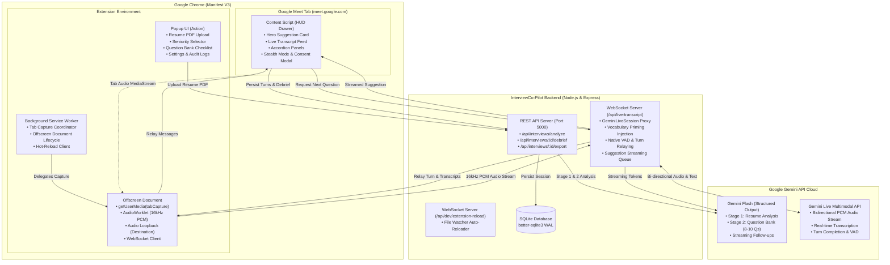
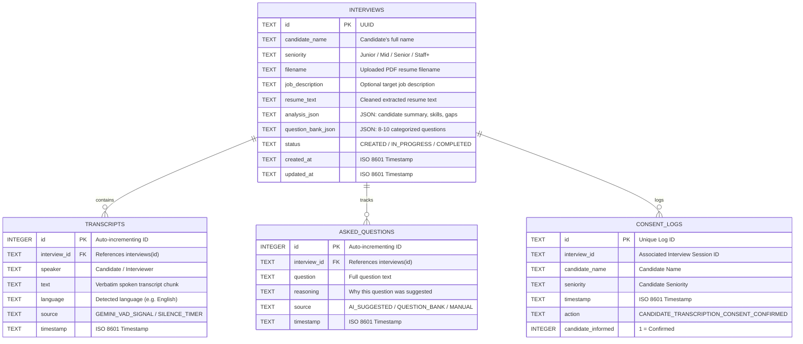

# InterviewCo-Pilot: Project & Features Technical Documentation

---

## 📖 Executive Summary

**InterviewCo-Pilot** is an advanced, AI-powered real-time interview co-pilot engineered specifically for technical interviewers conducting interviews via **Google Meet**. Combining a high-performance **Google Chrome Extension (Manifest V3)** with a resilient **Node.js/Express & WebSocket backend**, the system bridges the gap between deep technical vetting and interviewer cognitive bandwidth.

### The Problem It Solves
Technical interviewing is cognitively demanding:
- **High Interviewer Cognitive Load**: Interviewers must simultaneously listen actively, evaluate architecture and trade-offs, identify superficial buzzwords, formulate sharp follow-up questions, and take detailed notes.
- **Surface-Level Answers Go Unchallenged**: Candidates often memorize high-level patterns or buzzwords. Without real-time probing assistance, interviewers may miss subtle ambiguities or failure modes.
- **Domain & Vocabulary Gaps**: Speech-to-text models frequently mishear specialized terms (e.g., confusing *"Kubernetes"* with *"cooper netties"*, or stumbling on *"eBPF"*, *"gRPC"*, *"Kafka"*, *"p99 latency"*).
- **Inconsistent Candidate Evaluations**: Different interviewers probe different depths, leading to uneven interview signals across hiring loops.
- **Privacy & Screen Sharing Risks**: Interviewers sharing their screens or tabs risk exposing candidate notes or question rubrics.

### The Solution
InterviewCo-Pilot acts as a discreet, intelligent co-pilot sitting directly inside Google Meet:
1. **Pre-Call Intelligence**: Ingests candidate PDF resumes, synthesizes an executive profile, identifies 3–4 knowledge gaps/buzzwords to challenge, and generates a structured, calibrated 8–10 question bank tailored to the candidate's seniority level (`Junior`, `Mid`, `Senior`, `Staff+`).
2. **Live Meeting HUD**: Injects a clean, distraction-free Light Theme workspace on Google Meet, equipped with one-click **Stealth Mode** (blurring the panel during screen sharing) and absolute local-only browser rendering.
3. **Biased Audio Transcription**: Captures Google Meet tab audio via a dedicated Chrome Offscreen Document, processes linear 16kHz PCM audio via an `AudioWorklet`, and streams it to Google Gemini Live API primed with custom technical vocabulary extracted directly from the candidate's resume.
4. **Streaming Probing Engine**: Utilizes Gemini's Voice Activity Detection (VAD) and silence detection to automatically formulate a single, razor-sharp follow-up question interrogating the candidate's exact last answer, complete with rationale and anti-repetition tracking.
5. **Debrief & Export**: Concludes the interview with an end-of-call debrief and multi-format export (`.md`, `.txt`) backed by a persistent SQLite database.
6. **Ethical AI**: Enforces an explicit, mandatory Candidate Disclosure & Consent gate with persistent audit logging.

---

## 🏛️ System Architecture

InterviewCo-Pilot implements a decoupled client-server architecture adhering strictly to Google Chrome Manifest V3 specifications.



---

## 🧩 Architectural Components Deep Dive

### 1. Chrome Extension Layer (Manifest V3)

Due to Chrome Manifest V3's strict limitations (service workers cannot access `navigator.mediaDevices` or maintain long-running Web Audio contexts), InterviewCo-Pilot distributes responsibilities across specialized execution sandboxes:

#### A. Background Service Worker (`extension/background/background.js`)
- **Lifecycle & Messaging Hub**: Coordinates messaging between popup, content scripts, and offscreen documents.
- **Tab Capture Management**: Acquires a capture `MediaStreamId` via `chrome.tabCapture.getMediaStreamId({ targetTabId })`.
- **Offscreen Document Lifecycle**: Detects if an offscreen document exists via `chrome.offscreen.hasDocument()`, and dynamically spawns or terminates it with the `USER_MEDIA` reason flag.
- **Dev Hot-Reload Client**: Connects via WebSockets to the server's file watcher and calls `chrome.runtime.reload()` when extension files change during development.

#### B. Offscreen Audio Processing Document (`extension/offscreen/offscreen.html` & `offscreen.js`)
- **Tab Audio Capture**: Consumes the stream ID using `navigator.mediaDevices.getUserMedia({ audio: { mandatory: { chromeMediaSource: 'tab', chromeMediaSourceId: streamId } } })`.
- **Interviewer Audio Passthrough**: Connects the captured source node to `audioContext.destination`, ensuring the interviewer can hear the conversation through their speakers/headphones without interruption.
- **PCM Resampling Engine**: Employs an `AudioWorkletNode` (with fallback `ScriptProcessorNode`) that captures raw `Float32` audio and downsamples it into standard `16,000Hz Int16 Linear PCM` chunks.
- **Volatile Buffer Queue**: Buffers up to 150 chunks in-memory during brief network hiccups and flushes them upon WebSocket reconnection.
- **Base64 Encoding**: Encodes Int16 binary data to Base64 payloads and dispatches them over the WebSocket connection to `/api/live-transcript`.

#### C. Injected Meeting Workspace HUD (`extension/content/content.js` & `content.css`)
- **Seamless Injection**: Injected automatically into all `https://meet.google.com/*` tabs at `document_idle`.
- **High Z-Index & Isolation**: Styled with `#interview-copilot-root` (`z-index: 2147483647`) to sit comfortably on top of Google Meet's layout.
- **Non-Intrusive Floating Drawer**: Features an expandable/collapsible floating action button (FAB).
- **Stealth Mode Filter**: When enabled during screen sharing, applies a CSS filter (`opacity: 0.05; filter: blur(14px)`) that unblurs strictly when hovered, preventing candidates or attendees from reading confidential interview notes.
- **Dual Speech Recognition Pipeline**: Connects to the backend Gemini Live stream while maintaining an in-tab `webkitSpeechRecognition` fallback.

#### D. Popup UI (`extension/popup/popup.html`, `popup.js`, `popup.css`)
- **4-View Single-Page Interface**:
  1. **Home / Dashboard**: Backend health monitor, quick-launch button, active candidate snapshot, sidebar toggle switch.
  2. **New Interview Setup**: Drag-and-drop PDF dropzone, seniority level picker (`Junior`, `Mid`, `Senior`, `Staff+`), optional Job Description textarea, and analysis trigger.
  3. **Interview Hub**: Two-tab workspace showcasing the **Question Bank Checklist** with progress tracking (`0/8 Asked`), and the **Candidate Profile** with verified skills, notable projects, and knowledge gap cards.
  4. **Settings & Data Management**: Local storage inspector, active session reset, JSON export, candidate consent audit logs, and permanent data purge ("Danger Zone").

---

### 2. Backend & Server Layer (Node.js & Express)

#### A. Core API Server (`server/server.js`)
- **Port**: Default `5000` (configurable via `PORT` in `.env`).
- **Multer Memory Storage**: Handles PDF uploads in-memory (up to 10MB) without writing unencrypted resume files to disk.
- **Dual WebSocket Server Router**: Intercepts HTTP upgrade requests:
  - `/api/live-transcript`: Gemini Live audio transcription and streaming follow-up suggestions.
  - `/api/dev/extension-reload`: Extension hot-reloading broadcast.

#### B. PDF Text Extraction Service (`server/src/services/pdfService.js`)
- Dual-compatibility support for `pdf-parse` v1.x and v2.x.
- Extracts raw text, normalizes line endings (`\r\n` to `\n`), strips excessive whitespace, and validates text density before hand-off to Gemini.

#### C. Gemini Structured Analysis Service (`server/src/services/geminiService.js`)
- Powered by `@google/generative-ai` with structured JSON schema outputs (`responseMimeType: "application/json"`).
- **Model Fallback Chain**: Tries models sequentially (`GEMINI_MODEL`, `gemini-3.5-flash`, `gemini-2.5-flash`, `gemini-flash-latest`) to protect against regional availability quirks.
- **Rate-Limit Resilience**: Recognizes HTTP 429 and `RESOURCE_EXHAUSTED` errors and formats friendly client notices.
- **Stage 1 (Resume Analysis)**: Extracts candidate metadata, years of experience, executive summary, verified skills, notable projects, and 3–4 knowledge gaps with probing questions.
- **Stage 2 (Question Bank Generation)**: Generates 8–10 categorized technical questions calibrated to the chosen seniority level, paired with "What to look for" evaluation rubrics.

#### D. Gemini Live Real-Time Audio Proxy (`server/src/services/geminiLiveService.js`)
- Establishes a bidirectional WebSocket to Google's Multimodal Live API (`wss://generativelanguage.googleapis.com/ws/google.ai.generativelanguage.v1beta.GenerativeService.BidiGenerateContent`).
- **Dynamic Vocabulary Biasing**: Takes all skills and project names from the candidate's parsed resume and injects a strict system prompt instructing Gemini to prioritize exact technical spellings (e.g. *PostgreSQL*, *eBPF*, *GraphQL*, *Kafka*, *Raft*, *Cassandra*, *p99 latency*).
- **Native Voice Activity Detection (VAD)**: Translates Gemini's native `turnComplete` and `interrupted` server signals directly into client events.
- **Automatic Language Detection**: Detects non-English turns and extracts language tags (`[Lang: French]`, `[Lang: Spanish]`, etc.).

#### E. Streaming Follow-Up Suggestion Engine (`server/src/services/suggestionService.js`)
- **Serial Queue Manager**: Manages `SuggestionQueueManager` with automatic request throttling to protect free-tier quotas.
- **Stream Generation**: Generates exactly **one** short, sharp question targeting the candidate's last spoken answer using Gemini's streaming API (`generateContentStream`), delivering token-by-token updates to the meeting HUD.
- **Anti-Repetition Tracking**: Accepts an array of `alreadyAskedQuestions` and instructs the model never to repeat or circle back to covered ground.
- **Automatic Retry Backoff**: Performs an automatic 1500ms backoff and retry upon encountering an intermittent rate limit.

#### F. Persistent SQLite Store (`server/src/db/database.js` & `server/src/store/interviewStore.js`)
- File-backed database stored at `server/data/interview_copilot.db`.
- Operates in **WAL mode (Write-Ahead Logging)** for high-throughput concurrent reads and writes.
- Manages interviews, live transcript turns, asked questions, and consent audit trails.

---

## 🌟 Comprehensive Feature Catalog

### 1. Pre-Interview Intelligence & Seniority Calibration

| Feature | Description | Technical Implementation |
| :--- | :--- | :--- |
| **PDF Resume Parsing** | Accepts standard PDF resumes up to 10MB via drag-and-drop or file picker. | `multer.memoryStorage()`, `pdf-parse`, multi-version compatibility fallback. |
| **Seniority Level Calibration** | Adjusts technical expectations across 4 tiers: `Junior`, `Mid`, `Senior`, and `Staff+`. | Passed into Gemini's system prompts to tailor difficulty, architecture scope, and depth. |
| **Target Job Description Alignment** | Optional JD text input to focus question generation on specific team needs and tech stacks. | Concatenated into Stage 1 & Stage 2 analysis prompts. |
| **Candidate Profile Synthesis** | Synthesizes full name, years of experience, and a concise 2-sentence executive summary. | Gemini structured schema generation (`resumeAnalysisSchema`). |
| **Knowledge Gaps & Probing Areas** | Dissects buzzwords, unverified framework claims, and architecture trade-offs. | Identifies 3–4 specific gaps with reason to probe and ready-to-ask questions. |
| **Structured Question Bank** | Curates 8 to 10 high-signal interview questions grouped into logical categories. | Gemini structured schema generation (`questionBankSchema`). |
| **"What to Look For" Evaluation Criteria** | Provides interviewers with clear positive signals vs. red flags for each question. | Stored per question in the question bank schema and displayed in popup & sidebar. |

---

### 2. Google Meet In-Call Workspace (HUD)

| Feature | Description | Technical Implementation |
| :--- | :--- | :--- |
| **Light Theme Modern Design** | Clean, accessible white/slate aesthetic with purple/indigo brand accents. | CSS custom styling injected into page head with high specificity overrides. |
| **Expandable Floating Action Button (FAB)** | Collapses the full sidebar into a compact pill button in the top-right corner. | Transitions via CSS `transform: translateX(...)` and toggle classes. |
| **Stealth Mode (Anti-Screen-Share)** | Blurs the entire panel (14px Gaussian blur, 5% opacity) to hide questions if sharing screen. | `#interview-copilot-root.stealth` with `:hover` peek override. |
| **Zero Candidate Leakage** | Renders strictly inside the interviewer's local browser DOM; invisible to other participants. | Local DOM injection; Google Meet WebRTC stream does not capture browser extension DOM. |
| **Privacy Badge** | Displays a persistent "🔒 Private" pill reassuring the interviewer of local isolation. | Static UI badge in sidebar header. |

---

### 3. Audio Capture & Gemini Live Speech-to-Text

| Feature | Description | Technical Implementation |
| :--- | :--- | :--- |
| **Chrome Tab Capture (Manifest V3)** | Captures remote audio from the Google Meet call tab without external virtual cables. | `chrome.tabCapture.getMediaStreamId` delegated to Chrome Offscreen Document. |
| **Interviewer Passthrough Audio** | Guarantees that capturing audio does not mute the tab for the interviewer. | `sourceNode.connect(audioContext.destination)` in Offscreen Document. |
| **16kHz Int16 PCM Downsampler** | Downsamples browser tab audio (typically 44.1kHz or 48kHz) to 16,000Hz Linear PCM. | Custom `AudioWorkletProcessor` with Float32-to-Int16 linear interpolation. |
| **Technical Vocabulary Priming** | Prevents phonetic transcription errors on specialized tech terms and frameworks. | System prompt dynamic injection: extracts all candidate skills and project titles into Gemini Live API setup frame. |
| **Native Voice Activity Detection (VAD)** | Detects natural pauses and turn-taking without relying strictly on fixed timers. | Listens to Gemini Live `turnComplete` and `interrupted` protocol signals. |
| **Silence Safety Net** | Fallback trigger (2.5 seconds of silence) to finalize transcript turns if network packets drop. | JavaScript debounce timer resetting on interim transcript events. |
| **Language Auto-Detection** | Detects non-English candidate responses and tags the transcript feed. | Regular expression match for `[Lang: LanguageName]` emitted by Gemini. |

---

### 4. Real-Time Probing & AI Suggestion Engine

| Feature | Description | Technical Implementation |
| :--- | :--- | :--- |
| **Hero Suggestion Card** | Prominently displays the latest AI-generated follow-up question at the top of the HUD. | Dedicated gradient-bordered card with pulsating live status cursor. |
| **Streaming Token Display** | Follow-up questions render word-by-word in real time as Gemini generates them. | WebSocket streaming chunks (`SUGGESTION_CHUNK`) from `generateContentStream`. |
| **Answer-Specific Interrogation** | Formulates follow-ups that directly drill into what the candidate just said. | Prompt combines candidate context, gaps, and `lastAnswerTranscript`. |
| **"Why This Follows" Rationale** | Displays 1–2 sentences explaining what technical trade-off or ambiguity prompted the question. | Parsed from model stream and rendered below the question text. |
| **Anti-Repetition Tracking** | Guarantees that the AI never asks a question that was already asked earlier in the call. | Injects `alreadyAskedQuestions` list into prompt; updates on "Mark Asked". |
| **"⚡ Suggest Now" Manual Trigger** | Generates an immediate question from current discussion without waiting for candidate silence. | Content script button event initiating immediate suggestion request to WebSocket proxy. |
| **Quick Action Pill Buttons** | One-click "📋 Copy" (copies question to clipboard) and "✅ Mark Asked" (moves to history). | Clipboard API and state updater with dynamic checkmarks. |

---

### 5. In-Meeting Workflow & History Management

| Feature | Description | Technical Implementation |
| :--- | :--- | :--- |
| **Remaining Question Bank Accordion** | Interactive checklist of pre-generated questions. Clicking "Ask" triggers the question. | Collapsible accordion with remaining question counter (`X Remaining`). |
| **Live Conversation Transcript Feed** | Chronological feed of candidate answers with timestamps and speaker badges. | Auto-scrolling feed container with status dot (Standby, Listening, Suggesting). |
| **Q&A History Accordion** | Preserves all asked questions and their corresponding answers for review during the call. | Chronological list of Q&A cards stored in local state and SQLite. |
| **Candidate Profile Accordion** | Displays candidate bio, years of experience, verified skills, and probing areas inside Meet. | Collapsible card populated directly from extension storage. |

---

### 6. Ethics, Security & Post-Interview Debrief

| Feature | Description | Technical Implementation |
| :--- | :--- | :--- |
| **Mandatory Consent Modal Gate** | Blocks audio transcription until the interviewer explicitly confirms candidate disclosure. | Modal backdrop with disabled confirm button until checkbox is checked. |
| **Consent Audit Trail** | Logs disclosure timestamps, candidate name, and seniority level. | Persisted to Chrome local storage and SQLite `consent_logs` table. |
| **"🏁 End Interview" Workflow** | Stops recording cleanly, finalizes session state, and opens the Debrief Modal. | Triggers stream cleanup and loads aggregated stats from server. |
| **Multi-Format Session Export** | Generates formatted session transcripts and question logs in **Markdown (.md)** or **Plain Text (.txt)**. | Client-side blob downloader and server endpoint `/api/interviews/:id/export`. |
| **Persistent SQLite Storage** | Stores interview sessions, transcripts, and question logs across browser restarts. | `better-sqlite3` database with foreign key cascades and WAL mode. |
| **Developer Hot-Reloader** | Watches extension files and automatically reloads the unpacked extension in Chrome. | Node.js `fs.watch` connected to background service worker via WebSocket. |

---

## 🗄️ Database Schema & Data Models

InterviewCo-Pilot uses a file-backed SQLite database at `server/data/interview_copilot.db` running in **Write-Ahead Logging (WAL)** mode for concurrent access.



---

## 🔌 API & WebSocket Specifications

### 1. REST API Endpoints

#### `GET /health`
Returns service status, database engine, configured port, Gemini API key presence, and live transcription model.

**Response:**
```json
{
  "status": "ok",
  "service": "interview-copilot-backend",
  "storage": "SQLite (file-backed)",
  "timestamp": "2026-10-29T07:27:00.000Z",
  "port": 5000,
  "hasApiKey": true,
  "liveModel": "gemini-3.5-transcribe-live"
}
```

#### `POST /api/interviews/analyze`
Accepts `multipart/form-data` with a `resume` PDF file, `seniority` string, and optional `jobDescription`. Executes Stage 1 (Resume Analysis) and Stage 2 (Question Bank Generation) via Gemini structured output.

**Parameters:**
- `resume`: Binary PDF file (max 10MB)
- `seniority`: `"Junior"` | `"Mid"` | `"Senior"` | `"Staff+"` (Default: `"Mid"`)
- `jobDescription`: String (optional)

**Response:**
```json
{
  "success": true,
  "interviewId": "3fa85f64-5717-4562-b3fc-2c963f66afa6",
  "analysis": {
    "candidateName": "Alex Mercer",
    "yearsOfExperience": "7+ years",
    "summary": "Distributed systems engineer specializing in high-throughput Go and Kubernetes microservices.",
    "skills": ["Go", "Kubernetes", "Kafka", "gRPC", "PostgreSQL", "Docker", "AWS"],
    "notableProjects": [
      {
        "title": "Payment Ingestion Pipeline",
        "description": "Engineered real-time Kafka event streaming architecture processing 45k transactions/sec.",
        "technologies": ["Kafka", "Go", "PostgreSQL"]
      }
    ],
    "knowledgeGapsAndProbingAreas": [
      {
        "topic": "Distributed Consensus & Raft",
        "reasonToProbe": "Resume mentions custom consensus algorithm but lacks detail on partition tolerance.",
        "suggestedQuestion": "How does your consensus cluster handle split-brain scenarios during network partitions?"
      }
    ]
  },
  "questionBank": {
    "totalQuestions": 8,
    "questions": [
      {
        "id": "q1",
        "category": "System Design & Architecture",
        "question": "How did you guarantee idempotency in your Kafka payment ingestion pipeline?",
        "whatToLookFor": "Candidate should discuss deduplication keys, distributed locks, or outbox patterns.",
        "difficulty": "Senior"
      }
    ]
  },
  "metadata": {
    "filename": "Alex_Mercer_Resume.pdf",
    "seniority": "Senior",
    "hasJobDescription": true,
    "createdAt": "2026-10-29T07:27:00.000Z"
  }
}
```

#### `GET /api/interviews/:id`
Retrieves full interview details, structured analysis, and generated question bank by ID.

#### `GET /api/interviews`
Lists all recorded interview sessions in reverse chronological order.

#### `POST /api/interviews/:id/transcripts`
Records a finalized speech transcript turn in the database.

**Payload:**
```json
{
  "speaker": "Candidate",
  "text": "We used Kafka consumer groups and backed it with an outbox table in PostgreSQL.",
  "language": "English",
  "source": "GEMINI_VAD_SIGNAL",
  "timestamp": "2026-10-29T07:30:15.000Z"
}
```

#### `POST /api/interviews/:id/questions`
Records a question marked as asked by the interviewer.

**Payload:**
```json
{
  "question": "How did you guarantee idempotency in your Kafka payment ingestion pipeline?",
  "reasoning": "Candidate claimed 45k transactions/sec; verify deduplication strategy.",
  "source": "AI_SUGGESTED",
  "timestamp": "2026-10-29T07:31:00.000Z"
}
```

#### `GET /api/interviews/:id/debrief`
Returns aggregated debrief metrics including candidate overview, list of asked questions, and full transcript turns.

#### `GET /api/interviews/:id/export?format=markdown|text`
Streams a formatted export document as a downloadable file attachment (`interview-<id>.md` or `interview-<id>.txt`).

---

### 2. WebSocket Protocol (`ws://localhost:5000/api/live-transcript`)

#### Client to Server Messages:

| Message Type | Payload Structure | Description |
| :--- | :--- | :--- |
| `INIT_SESSION` | `{ type: "INIT_SESSION", candidateData: { candidateName, skills, projects } }` | Initializes Gemini Live session with domain technical vocabulary priming. |
| `AUDIO_CHUNK` | `{ type: "AUDIO_CHUNK", data: "<base64-pcm-16khz>" }` | Streams base64-encoded 16kHz Int16 linear PCM audio chunks. |
| `REQUEST_NEXT_QUESTION` | `{ type: "REQUEST_NEXT_QUESTION", payload: { lastAnswerTranscript, resumeSummary, questionBank, alreadyAskedQuestions } }` | Triggers streaming generation of the next follow-up question. |
| `STOP` | `{ type: "STOP" }` | Cleanly closes and tears down the active Gemini Live proxy session. |

#### Server to Client Messages:

| Message Type | Payload Structure | Description |
| :--- | :--- | :--- |
| `STATUS` | `{ type: "STATUS", status: "READY", vocabularyCount: 14, message: "..." }` | Confirms Gemini Live session is connected and primed. |
| `TRANSCRIPT_CHUNK` | `{ type: "TRANSCRIPT_CHUNK", text: "...", isFinal: true/false, language: "English" }` | Emits live speech-to-text transcription as candidate speaks. |
| `LANGUAGE_DETECTED`| `{ type: "LANGUAGE_DETECTED", language: "Spanish" }` | Emits notification when speaker language changes. |
| `TURN_COMPLETE` | `{ type: "TURN_COMPLETE", source: "GEMINI_VAD_SIGNAL" }` | Emitted when Gemini's native VAD identifies the candidate has finished speaking. |
| `SPEAKER_INTERRUPTED`| `{ type: "SPEAKER_INTERRUPTED" }` | Emitted when the candidate begins speaking while another turn was processing. |
| `SUGGESTION_START` | `{ type: "SUGGESTION_START" }` | Notifies HUD that token generation for the next question has begun. |
| `SUGGESTION_CHUNK` | `{ type: "SUGGESTION_CHUNK", text: "word" }` | Streams token-by-token text of the proposed question. |
| `SUGGESTION_DONE` | `{ type: "SUGGESTION_DONE", fullText: "..." }` | Indicates that the suggestion has finished streaming. |
| `ERROR` | `{ type: "ERROR", message: "..." }` | Relays error notices and rate-limit warnings. |

---

## 🚀 Setup & Installation Guide

### Prerequisites
- **Node.js**: v18.0.0 or higher
- **npm**: v9.0.0 or higher
- **Google Chrome**: Version 116+ (requires Manifest V3 and Chrome Offscreen Document support)
- **Google Gemini API Key**: Obtainable from [Google AI Studio](https://aistudio.google.com/)

---

### Step 1: Configure & Start the Backend Server

1. **Navigate to the server directory**:
   ```bash
   cd server
   ```

2. **Install project dependencies**:
   ```bash
   npm install
   ```

3. **Configure environment variables**:
   Create a `.env` file from `.env.example`:
   ```bash
   # On Windows PowerShell
   Copy-Item .env.example .env

   # On Linux / macOS
   cp .env.example .env
   ```

4. **Add your Gemini API Key**:
   Open `.env` and configure:
   ```env
   PORT=5000
   GEMINI_API_KEY=your_actual_gemini_api_key_here
   GEMINI_MODEL=gemini-3.5-flash
   GEMINI_TRANSCRIBE_MODEL=models/gemini-2.5-flash-native-audio-latest
   ```

5. **Start the server**:
   ```bash
   # Development mode with hot-reloading
   npm run dev

   # Standard production start
   npm start
   ```

6. **Verify server health**:
   Open `http://localhost:5000/health` in your browser. You should see `{"status":"ok", ...}`.

---

### Step 2: Load the Extension in Google Chrome

1. Open Google Chrome and enter `chrome://extensions` in the address bar.
2. Enable **Developer mode** via the toggle switch in the top right corner.
3. Click the **Load unpacked** button in the top left.
4. Select the `extension/` directory of this repository:
   ```
   InterviewCo-Pilot/extension
   ```
5. The **InterviewCo-Pilot** extension icon will appear in your Chrome toolbar.
6. *(Recommended)* Pin the extension icon to your toolbar for quick access.

---

## 💻 Step-by-Step User Walkthrough

### Phase 1: Pre-Interview Setup
1. Click the **InterviewCo-Pilot** toolbar icon to open the popup.
2. Click **"New Interview Setup"**.
3. Drag and drop the candidate's PDF resume into the dropzone.
4. Select the target **Seniority Level** (`Junior`, `Mid`, `Senior`, or `Staff+`).
5. *(Optional)* Paste the job description or specific technology requirements.
6. Click **"Analyze & Generate Questions"**.
7. In seconds, review the generated **Question Bank** checklist and **Candidate Profile Briefing** (skills, project highlights, and knowledge gaps).

### Phase 2: Joining the Google Meet Call
1. Join your scheduled Google Meet room at `https://meet.google.com/<meeting-code>`.
2. Notice the **InterviewCo-Pilot** workspace injected on the right side of the screen.
3. *(Optional)* If you plan to share your screen, click **"👁️ Stealth"** in the top header. The panel blurs automatically so the candidate cannot read your notes.

### Phase 3: Live Co-Piloting
1. Click **"Start Interview (Live Transcribe)"**.
2. **Mandatory Consent Check**: A disclosure modal appears. Inform the candidate that AI-assisted transcription is active, check the confirmation box, and click **"Confirm & Start Interview"**.
3. As the candidate speaks:
   - Live speech-to-text streams into the **Live Transcript Feed**, primed with the candidate's exact technical stack.
   - When the candidate pauses or finishes speaking, Gemini Live's VAD triggers a turn completion.
   - The **Hero Suggestion Card** immediately streams a follow-up question interrogating their answer, along with the technical rationale.
4. Click **"📋 Copy"** to copy the question to your clipboard, or click **"✅ Mark Asked"** once delivered.
5. Alternatively, pick any pre-prepared question from the **Remaining Question Bank** accordion by clicking **"Ask"**.

### Phase 4: Debrief & Export
1. When the call concludes, click **"🏁 End Interview"**.
2. Review the aggregated interview summary, questions asked, and conversation transcript turns.
3. Click **"📄 Download Markdown (.md)"** or **"📝 Download Text (.txt)"** to save your structured interview notes directly to your machine or paste them into your ATS (e.g. Greenhouse, Lever, Ashby).

---

## 🔒 Security, Privacy & Compliance

InterviewCo-Pilot was designed from the ground up with strict privacy and enterprise security principles:

1. **Local-Only Browser HUD**:
   The injected sidebar is added directly to the interviewer's local DOM and operates outside the Google Meet WebRTC media stream. Remote participants, meeting recordings, and Google Meet transcripts have zero awareness of or access to the co-pilot.
2. **Volatile Audio Streaming**:
   Tab audio is captured in volatile memory chunks, downsampled in an isolated `AudioWorklet`, streamed over WebSockets, and never written to raw audio files on disk.
3. **In-Memory PDF Parsing**:
   Uploaded PDF resumes are processed directly in Node.js memory buffers via Multer and are not stored permanently on server storage.
4. **Mandatory Candidate Consent**:
   The extension strictly prevents any audio capture or transcription until the interviewer confirms that the candidate has been informed. All consent events are logged with immutable timestamps in local audit storage.
5. **No Third-Party Telemetry**:
   All conversation turns, question logs, and debrief notes reside strictly within your local machine (`SQLite` file and `chrome.storage.local`). No external telemetry, tracking pixels, or third-party databases are used.

---

## 📂 Repository File Structure

```
InterviewCo-Pilot/
├── extension/                         # Google Chrome Extension (Manifest V3)
│   ├── manifest.json                  # Manifest V3 configuration & permissions
│   ├── background/
│   │   └── background.js              # Service worker: Tab capture & offscreen lifecycle
│   ├── content/
│   │   ├── content.js                 # Injected Google Meet workspace HUD logic
│   │   └── content.css                # Sidebar layout, animations & stealth styling
│   ├── offscreen/
│   │   ├── offscreen.html             # Offscreen host document
│   │   └── offscreen.js               # AudioWorklet downsampler (16kHz PCM) & WebSocket client
│   ├── popup/
│   │   ├── popup.html                 # Extension action popup interface
│   │   ├── popup.css                  # Modern light/dark responsive popup styling
│   │   └── popup.js                   # Resume upload, stage 1 & 2 analysis & settings logic
│   └── icons/                         # Extension icons (16x16, 48x48, 128x128)
│       ├── icon16.png
│       ├── icon48.png
│       └── icon128.png
├── server/                            # Node.js / Express Backend
│   ├── server.js                      # Express HTTP server & dual WebSocket handlers
│   ├── package.json                   # Dependencies & build scripts
│   ├── .env.example                   # Environment configuration template
│   ├── data/                          # SQLite persistent storage directory
│   │   └── interview_copilot.db       # SQLite file database (WAL mode)
│   └── src/
│       ├── db/
│       │   └── database.js            # SQLite connection & schema initialization
│       ├── services/
│       │   ├── geminiService.js       # Stage 1 (Analysis) & Stage 2 (Question Bank)
│       │   ├── geminiLiveService.js   # Bidirectional Gemini Live WebSocket proxy
│       │   ├── pdfService.js          # In-memory PDF text extraction
│       │   └── suggestionService.js   # Serialized streaming follow-up question engine
│       └── store/
│           └── interviewStore.js      # Interview state management, debriefs & export
├── .gitignore
├── README.md                          # Quick start instructions
└── PROJECT_DOCUMENTATION.md           # Comprehensive project & features documentation
```

---

*Authored for the InterviewCo-Pilot Engineering Team • Powered by Google Gemini 3.5 & Multimodal Live API*

